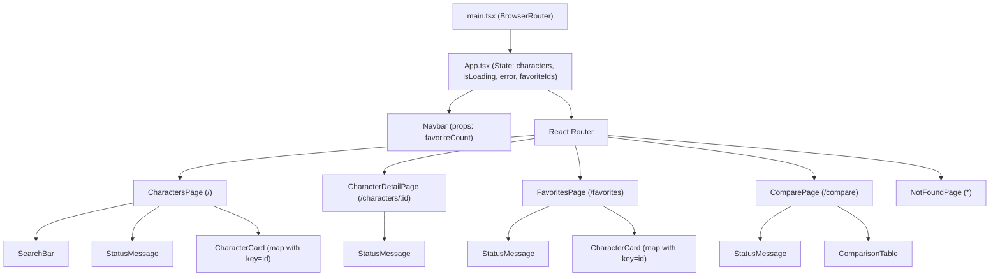

# Architecture & Defense Guide: Star Wars Character Explorer

This document explains how the application is structured, where state lives, how routing and API requests work, and what the unit tests verify.

---

## 1. Folder & File Structure

```text
src/
├── main.tsx                        # Entry point: mounts <BrowserRouter> + <App />
├── App.tsx                         # Top-level state (characters, favorites) & <Routes>
├── App.css                         # Component & responsive layout styles
├── index.css                       # Global CSS variables & galaxy starfield theme
├── types/
│   └── character.ts                # TypeScript interfaces (SwapiCharacter, SwapiPlanet, SwapiFilm, SwapiStarship)
├── utils/
│   ├── swapiHelpers.ts             # Pure helper functions (ID extraction, number parsing, search, compare, favorites)
│   └── swapiHelpers.test.ts        # 8 Vitest unit tests testing swapiHelpers.ts
├── data/
│   └── mockCharacters.json         # Sample SWAPI dataset used in Task 1 and unit tests
├── components/                     # 5 reusable custom components (each in its own file)
│   ├── Navbar.tsx                  # Top navigation bar using NavLink + favorites badge
│   ├── CharacterCard.tsx           # Summary card for a single character with star toggle & Link
│   ├── SearchBar.tsx               # Controlled search input with clear button & match counter
│   ├── StatusMessage.tsx           # Loading spinner & error alert with retry button
│   └── ComparisonTable.tsx         # Side-by-side stat table highlighting higher numeric values
└── pages/                          # 5 routed page views
    ├── CharactersPage.tsx          # "/" — Master list + SearchBar + CharacterCard grid
    ├── CharacterDetailPage.tsx     # "/characters/:id" — Full character dossier (useParams + parallel fetch)
    ├── FavoritesPage.tsx           # "/favorites" — Starred characters saved in localStorage
    ├── ComparePage.tsx             # "/compare" — Two-character selector + ComparisonTable
    └── NotFoundPage.tsx            # "*" — 404 route fallback
```

---

## 2. Component Hierarchy & Data Flow



---

## 3. Where State Lives and Why

| State | File | Why it lives there |
|---|---|---|
| `characters`, `isLoading`, `error`, `reloadCount` | `src/App.tsx` | Shared across three pages (`CharactersPage`, `FavoritesPage`, and `ComparePage`) so switching tabs in the navbar is instant and doesn't re-fetch the 82 characters each time. |
| `favoriteIds` | `src/App.tsx` (+ synced to `localStorage`) | Needed by `Navbar` (badge count), `CharactersPage` (star buttons), `CharacterDetailPage` (star button), and `FavoritesPage` (list of starred characters). Lifting it to `App.tsx` keeps all pages in sync. |
| `searchQuery` | `src/pages/CharactersPage.tsx` | Only affects the character list search filter on `/`, so keeping it local to `CharactersPage` avoids unnecessary state in `App.tsx`. |
| `character`, `homeworld`, `films`, `starships`, `isLoading`, `error` | `src/pages/CharacterDetailPage.tsx` | Specific to whichever `:id` is currently open at `/characters/:id`. Fetched on mount or when `:id` changes. |
| `firstId`, `secondId` | `src/pages/ComparePage.tsx` | Only used by the two dropdowns on `/compare`. |

---

## 4. What Happens From Clicking a Character to Seeing Details

1. In `CharacterCard.tsx`, we extract the character's ID from `character.url` using `extractIdFromUrl(character.url)` (for example, `"https://swapi.info/api/people/1"` -> `"1"`).
2. Clicking the character's name or `"Open Dossier →"` triggers React Router's `<Link to="/characters/1">`, changing the browser URL without a full page reload.
3. `<Route path="/characters/:id" element={<CharacterDetailPage ... />} />` matches the URL.
4. Inside `CharacterDetailPage.tsx`, `useParams<{ id: string }>()` reads `id = "1"` from the URL.
5. `useEffect` runs whenever `id` changes:
   - Sets `isLoading = true` and renders `<StatusMessage variant="loading" />`.
   - Fetches `https://swapi.info/api/people/1`.
   - Uses `Promise.all` to fetch `character.homeworld`, all URLs in `character.films`, and all URLs in `character.starships` in parallel.
   - Updates state and sets `isLoading = false`, rendering the full dossier (planet name + terrain, sorted films, and piloted starships).
   - If the request fails (for example, clicking `RECORD #17`, which returns HTTP 404 on SWAPI), the `catch` block sets `error` and renders `<StatusMessage variant="error" />` with a `"Try Again"` button.

---

## 5. What the Unit Tests Check (`src/utils/swapiHelpers.test.ts`)

1. **`extractIdFromUrl`**: Extracts the final numeric ID from SWAPI URLs with or without a trailing slash (`"https://swapi.info/api/people/42/"` -> `"42"`).
2. **`parseSwapiNumber` (valid numbers)**: Converts numeric strings (`"172"`) and comma-formatted strings (`"1,358"`) into JavaScript numbers.
3. **`parseSwapiNumber` (unknown values)**: Returns `null` for `"unknown"`, `"N/A"`, or empty strings instead of `NaN`.
4. **`formatSwapiMeasurement`**: Appends units (`"172 cm"`) or returns `"Unknown"` when the value is not a valid number.
5. **`filterCharactersByName`**: Performs case-insensitive substring matching (`"  SKY "` matches `"Luke Skywalker"`) and returns the full list when the query is blank.
6. **`compareNumericValues`**: Returns `'first'`, `'second'`, `'tie'`, or `'unknown'` when comparing two stats for `ComparisonTable`.
7. **`toggleFavoriteId`**: Adds an ID if not present and removes it if already present without mutating the original array.
8. **`withMissingSwapiRecord17`**: Inserts placeholder Record `#17` between `#16` and `#18` so the archive sequence is continuous and clicking `#17` demonstrates SWAPI's HTTP 404 error state.
